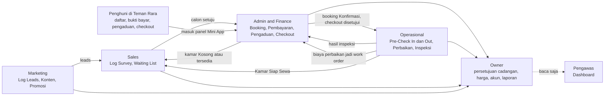

# Diagram Alir Kasus Operasional per Role

Kumpulan diagram alir untuk kasus-kasus operasional yang bisa terjadi dari fitur yang sudah ada di **Mini App**, **Dashboard**, **Teman Rara**, dan **Inventory Stock**. Satu file per role. Setiap kasus berisi: kapan terjadi, diagram alir (Mermaid), checklist, dan hal yang perlu diperhatikan.

Sumber fakta: kode aplikasi dan `docs/PANDUAN-PEMAKAIAN.md`. Diagram tampil langsung di GitHub. Versi PDF (diagram sudah ter-render) disimpan di folder Dokumen Panduan masing-masing divisi di Google Drive.

| Role | File | Jumlah kasus |
|---|---|---|
| Owner | [owner.md](owner.md) | 11 |
| Pengawas | [pengawas.md](pengawas.md) | 6 |
| Admin and Finance | [admin-finance.md](admin-finance.md) | 17 |
| Sales | [sales.md](sales.md) | 9 |
| Marketing | [marketing.md](marketing.md) | 7 |
| Operasional | [operasional.md](operasional.md) | 12 |

## Peta serah-terima antar role

## Siklus status kamar (ringkas)

Kosong, Booking, Terisi, dan Maintenance berubah otomatis. Detail pemicu Maintenance ada di [operasional.md](operasional.md), kasus K1.

## Catatan penggunaan

- Diagram dibuat dari perilaku aplikasi saat ini. Bila fitur berubah, ubah file `.md` lalu buat ulang PDF-nya.
- Angka target KPI mengikuti `docs/PANDUAN-PEMAKAIAN.md`. Target bisa diubah di halaman Target KPI di Dashboard oleh Owner atau kepala divisi, jadi cek angka terbaru di sana.
- Pengawas tidak punya folder Dokumen Panduan sendiri di Drive. Filenya tersedia di repo ini.
