# Diagram Alir Kasus Operasional: Admin and Finance

Peran: memegang penghuni dan uang. Penghuni baru, pembayaran, checkout, pengaduan, pembukuan, dan laporan keuangan. Admin and Finance adalah penanggung jawab utama Teman Rara dari sisi pengelola.

Aplikasi yang dipakai: **Mini App** (form harian, Check-in dan Check-out, Pengaturan, Laporan, Status Kamar), **Dashboard** (Overview, Daftar Penghuni, Data Pembayaran, Daftar Vendor, Stok Inventory, Dokumen, Target KPI), **Inventory Stock** (lihat dan pembelian), **Teman Rara** (semua panel pengelola ada di Mini App).

Cara membaca diagram: kotak = langkah, belah ketupat = keputusan. Nama di awal kotak menunjukkan siapa yang mengerjakan.

| No | Kasus | Aplikasi |
|---|---|---|
| K1 | Booking langsung (walk-in atau WhatsApp) sampai penghuni masuk | Mini App |
| K2 | Pendaftaran mandiri dari Teman Rara | Teman Rara, Mini App |
| K3 | Penghuni membayar sewa atau DP | Mini App |
| K4 | Penghuni mengunggah bukti bayar | Teman Rara, Mini App |
| K5 | Perpanjangan sewa | Mini App |
| K6 | Salah catat pembayaran: void atau koreksi | Mini App |
| K7 | Penghuni mengajukan checkout | Teman Rara, Mini App |
| K8 | Pengaduan penghuni dari Teman Rara | Teman Rara, Mini App |
| K9 | Mencatat pengeluaran dan pemasukan non-sewa | Mini App |
| K10 | Biaya perbaikan dari Operasional | Mini App |
| K11 | Penagihan jatuh tempo dan tunggakan | Dashboard, Mini App |
| K12 | Tutup bulan dan laporan keuangan | Mini App, Dashboard |
| K13 | Stok menipis: belanja bahan | Inventory, Mini App |
| K14 | Pengumuman, akun ganda, dan WiFi | Teman Rara, Mini App |
| K15 | Pencatatan: pelanggaran, kecelakaan kerja, kepuasan | Mini App |
| K16 | Status kamar tidak cocok dengan kenyataan | Mini App |

---

## K1. Booking langsung (walk-in atau WhatsApp) sampai penghuni masuk

**Kapan terjadi:** calon penghuni survey lalu setuju, atau memesan lewat WhatsApp.

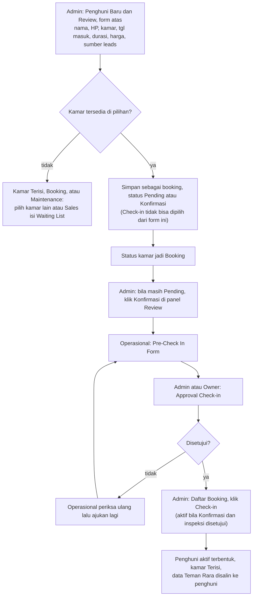

**Checklist**
- [ ] Tambahan listrik per bulan dan nama barang elektronik tambahan diisi bila ada.
- [ ] Nopol dan nama kendaraan diisi bila ada (satu nopol satu penghuni aktif).
- [ ] Dokumen identitas dan kontrak diunggah (maksimal 2 MB per berkas).
- [ ] Tombol Check-in abu-abu: arahkan kursor, alasannya tertulis.

**Perhatikan:** Check-in tidak bisa dicatat dari form Penghuni Baru maupun Edit Data. Hanya lewat Daftar Booking setelah SOP selesai.

---

## K2. Pendaftaran mandiri dari Teman Rara

**Kapan terjadi:** calon penghuni mengisi form sendiri di Teman Rara. Masuk sebagai booking berstatus Pending.

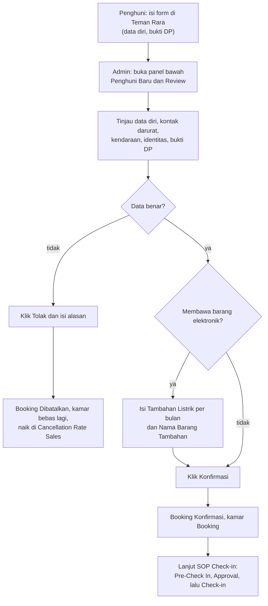

**Perhatikan:** Konfirmasi belum membuat penghuni. Penghuni terbentuk saat tombol Check-in ditekan. Saat itu hanya kolom kosong yang disalin dari Teman Rara, jadi koreksi manual tidak tertimpa. Nopol yang formatnya tidak dikenali atau sudah dipakai penghuni lain tidak disalin: isi manual di Ubah Data Penghuni.

---

## K3. Penghuni membayar sewa atau DP

**Kapan terjadi:** uang masuk dari penghuni atau calon penghuni.

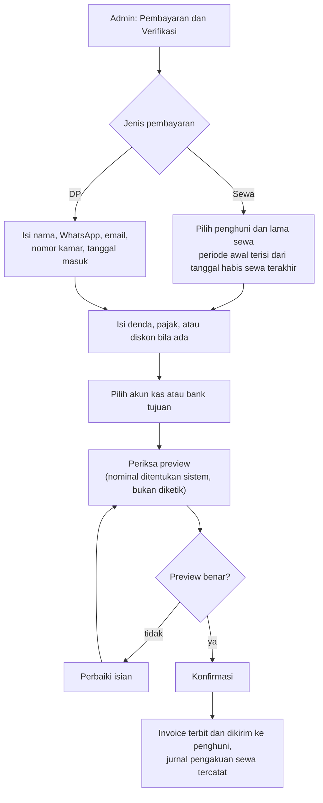

**Checklist**
- [ ] Periode Awal Sewa tidak diubah kecuali memang berbeda.
- [ ] Diskon, pajak, dan denda hanya diisi bila ada.
- [ ] Setelah konfirmasi, tunggu pesan sukses sebelum menutup halaman.

**Perhatikan:** DP otomatis 50% dari tarif 1 bulan. Diskon tercatat sebagai pengurang pendapatan, bukan beban.

---

## K4. Penghuni mengunggah bukti bayar

**Kapan terjadi:** penghuni transfer lalu mengunggah bukti di Teman Rara.

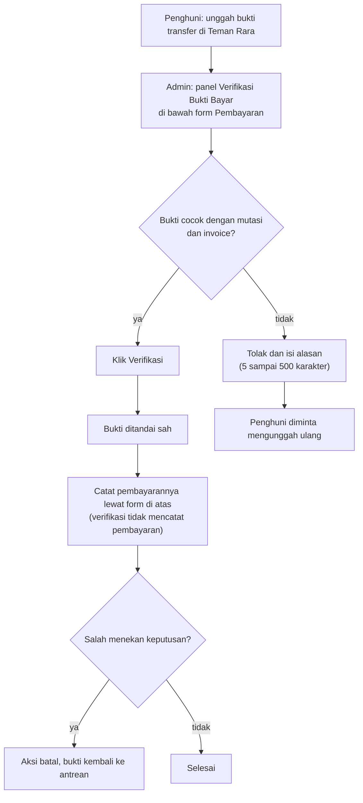

**Perhatikan:** invoice yang sudah di-void tidak bisa diunggah bukti bayarnya. Bukti juga bisa ditautkan atau dilepas di Riwayat Pembayaran.

---

## K5. Perpanjangan sewa

**Kapan terjadi:** sewa penghuni mendekati jatuh tempo (muncul di Daftar Jatuh Tempo 7 hari ke depan).

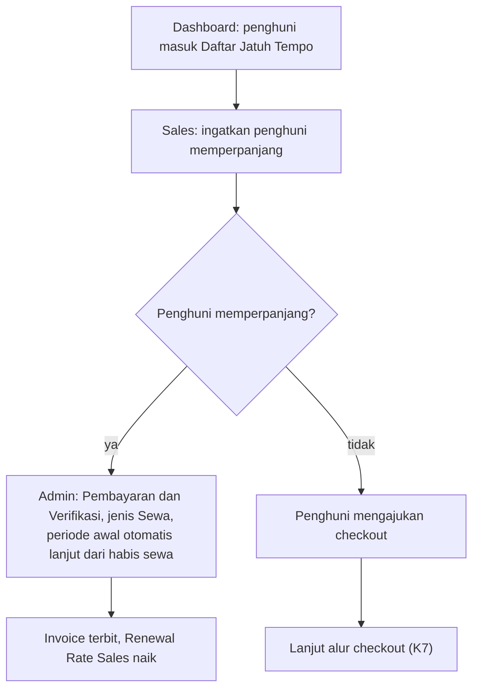

---

## K6. Salah catat pembayaran: void atau koreksi

**Kapan terjadi:** nominal atau periode salah, atau pembayaran batal. Hanya Owner dan Admin and Finance yang bisa.

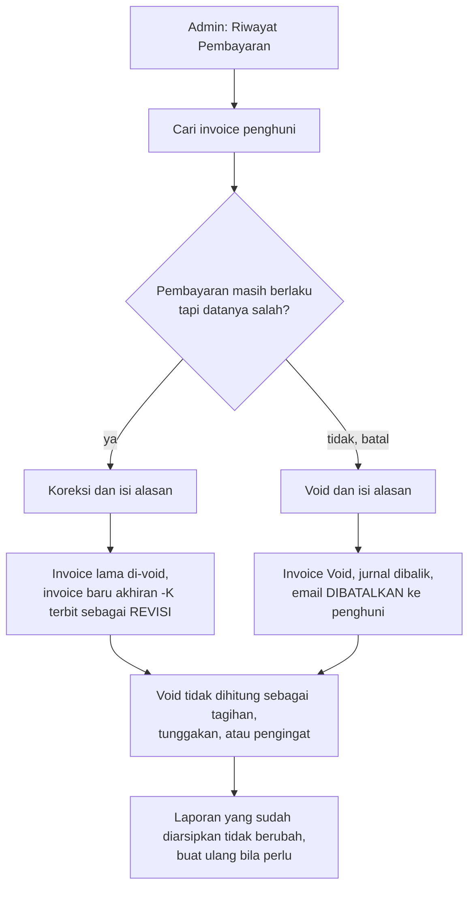

**Perhatikan:** jangan membuat entri ganda untuk menimpa yang lama. Salah tautan bukti transfer: lepas di Riwayat Pembayaran, berkas di Drive tidak terhapus.

---

## K7. Penghuni mengajukan checkout

**Kapan terjadi:** penghuni mengajukan keluar di Teman Rara, atau Admin mencatat langsung.

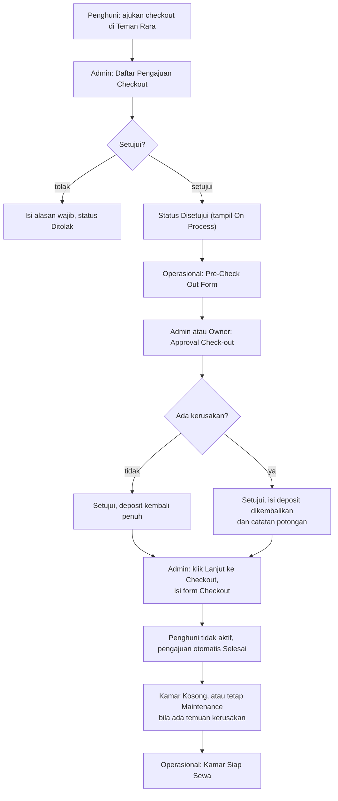

**Checklist**
- [ ] Tunggakan terisi otomatis dari riwayat pembayaran, periksa sebelum simpan.
- [ ] Deposit diputuskan di Approval Check-out, bukan di form Checkout.
- [ ] Pengembalian deposit tidak bisa melebihi deposit asli (dibaca dari database).

---

## K8. Pengaduan penghuni dari Teman Rara

**Kapan terjadi:** penghuni aktif mengirim pengaduan. Target tanggapan paling lama 1 jam.

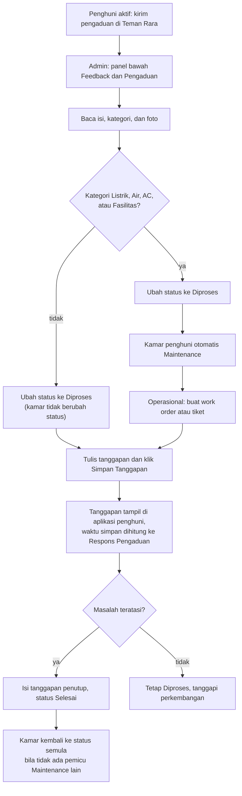

**Checklist**
- [ ] Tanggapan diisi sebelum status Selesai atau Dibatalkan (wajib).
- [ ] Pengaduan dari penghuni yang sudah tidak aktif tidak mengubah status kamar (muncul peringatan).
- [ ] Komplain lisan dicatat di form atas Feedback dan Pengaduan. Saran dan kritik masuk log feedback.

---

## K9. Mencatat pengeluaran dan pemasukan non-sewa

**Kapan terjadi:** bayar listrik, internet, gaji, belanja, atau terima uang di luar sewa (mis. laundry).

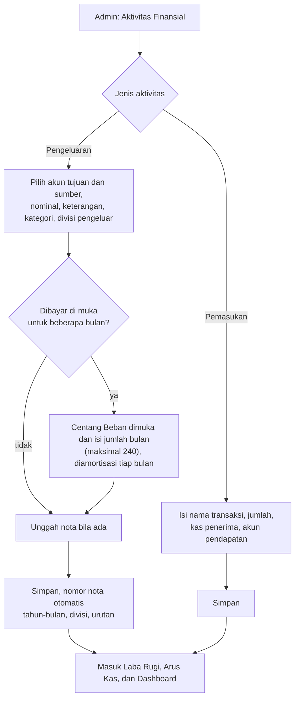

**Perhatikan:** penyusutan dan bunga pinjaman bukan OPEX. Keduanya hanya mengurangi laba bersih.

---

## K10. Biaya perbaikan dari Operasional

**Kapan terjadi:** tiket perawatan atau perbaikan diisi dengan biaya lebih dari nol. Biaya tidak langsung masuk pembukuan.

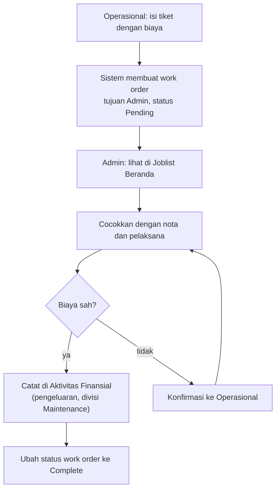

**Perhatikan:** work order ini membawa referensi tiket asal. Bila tertulis gagal masuk Joblist Admin, catat pengeluaran manual dengan referensi tiket.

---

## K11. Penagihan jatuh tempo dan tunggakan

**Kapan terjadi:** pemeriksaan mingguan.

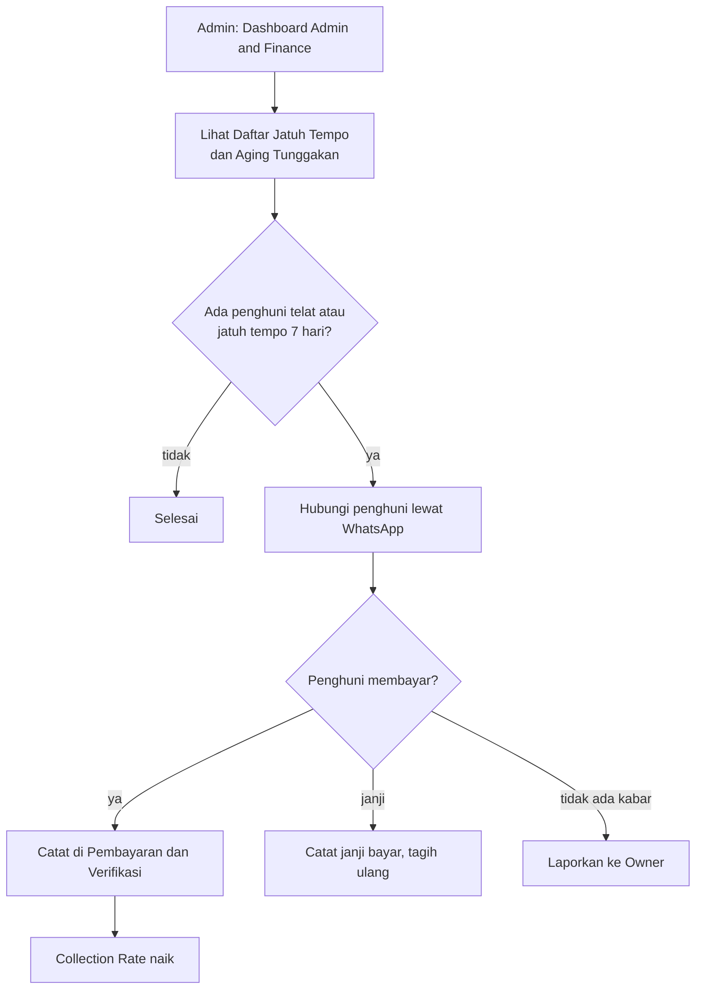

**Perhatikan:** target Collection Rate 100% dan penghuni menunggak paling banyak 2.

---

## K12. Tutup bulan dan laporan keuangan

**Kapan terjadi:** akhir sampai awal bulan. Target tutup buku 1 hari kerja setelah akhir bulan.

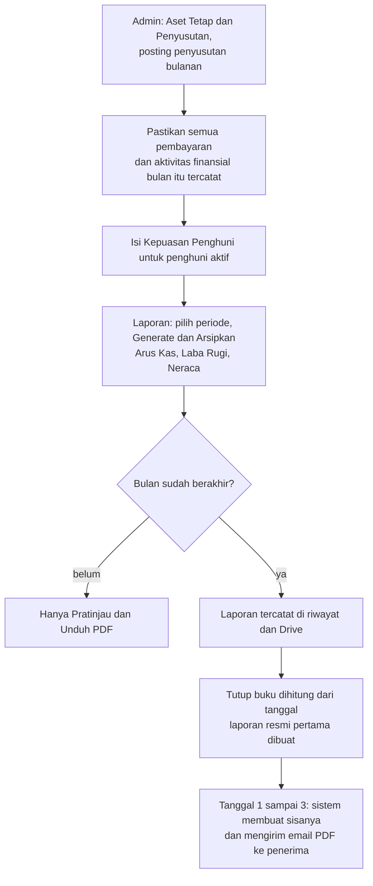

**Checklist**
- [ ] Penyusutan bulan ini sudah diposting.
- [ ] Tidak ada pembayaran atau pengeluaran yang tertunda dicatat.
- [ ] Email tujuan laporan benar (diatur Owner).

---

## K13. Stok menipis: belanja bahan

**Kapan terjadi:** Operasional melaporkan stok menipis, atau Dashboard Stok Inventory menampilkan bahan di bawah batas minimum.

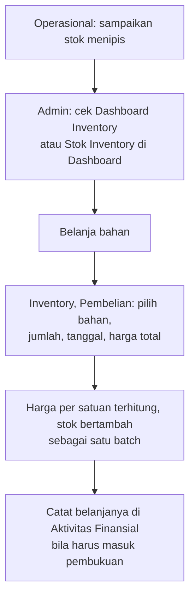

**Perhatikan:** Inventory tidak membuat jurnal keuangan otomatis, jadi pembelian di sana tidak ikut masuk Laba Rugi. Catat belanja di Aktivitas Finansial bila ingin tercatat di pembukuan.

---

## K14. Pengumuman, akun ganda, dan WiFi

**Kapan terjadi:** informasi untuk penghuni, akun Teman Rara bermasalah, atau password WiFi diganti.

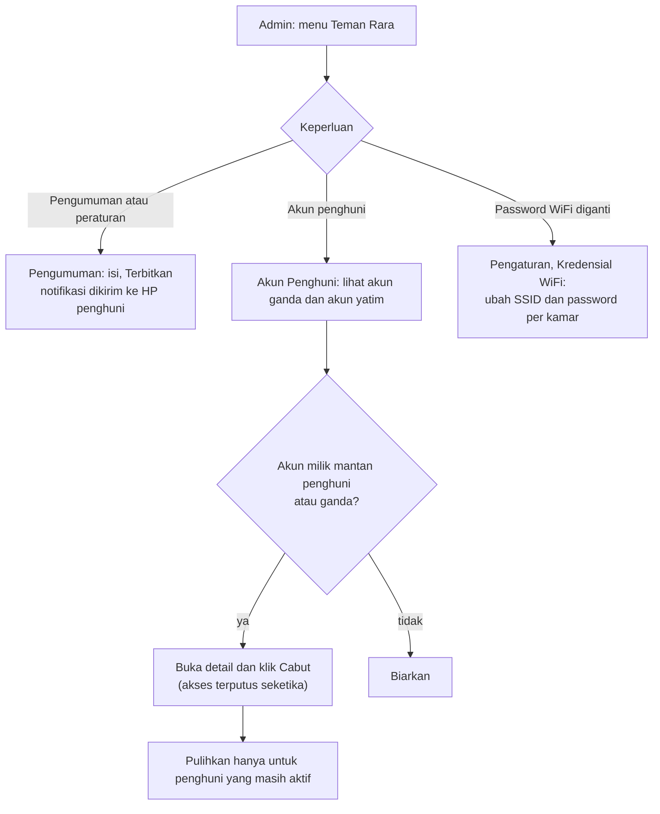

---

## K15. Pencatatan: pelanggaran, kecelakaan kerja, kepuasan

**Kapan terjadi:** kejadian pelanggaran peraturan, kecelakaan kerja, atau survei kepuasan bulanan.

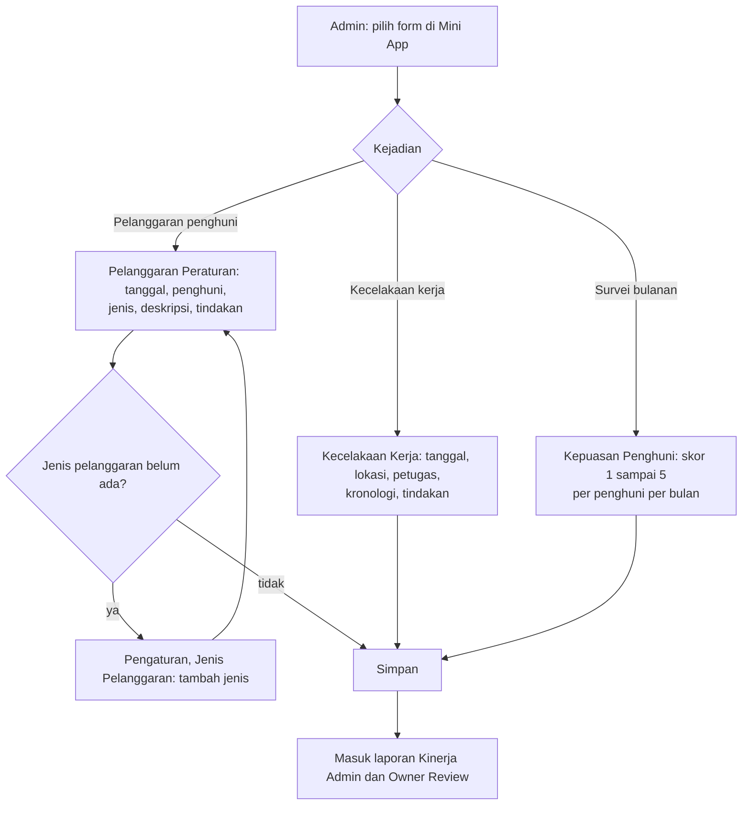

---

## K16. Status kamar tidak cocok dengan kenyataan

**Kapan terjadi:** kamar tertulis Kosong padahal ada booking, atau data lama belum selaras.

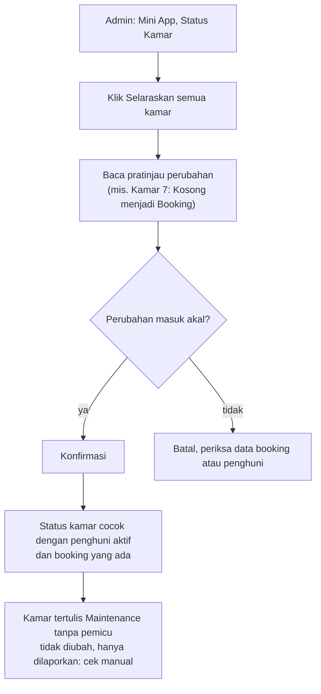

---

## Ringkasan: kasus, KPI, dan hal yang perlu dicek

| Kasus | KPI terkait | Target |
|---|---|---|
| K1, K2 | Kamar kosong | 0 |
| K3, K11 | Collection Rate, penghuni menunggak | 100%, paling banyak 2 |
| K3, K9 | Pendapatan, laba bersih | Rp26 juta, Rp15 juta per bulan |
| K3 | Total diskon | Paling tinggi 10% dari pendapatan |
| K8 | Respons pengaduan | Paling lama 1 jam |
| K9, K10 | OPEX per kamar | Paling tinggi Rp300 ribu per bulan |
| K12 | Tutup buku | 1 hari kerja setelah akhir bulan |
| K1, K15 | Dokumen penghuni lengkap | 100% |
