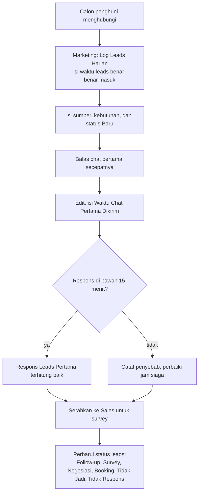
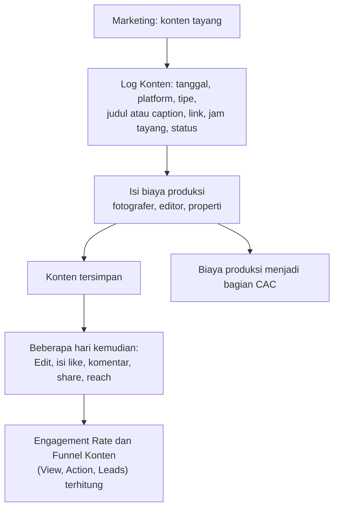
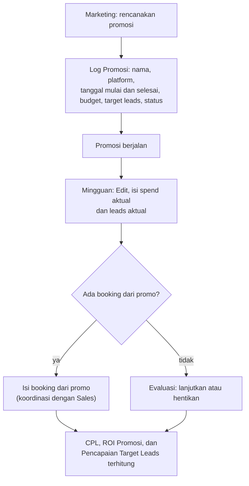
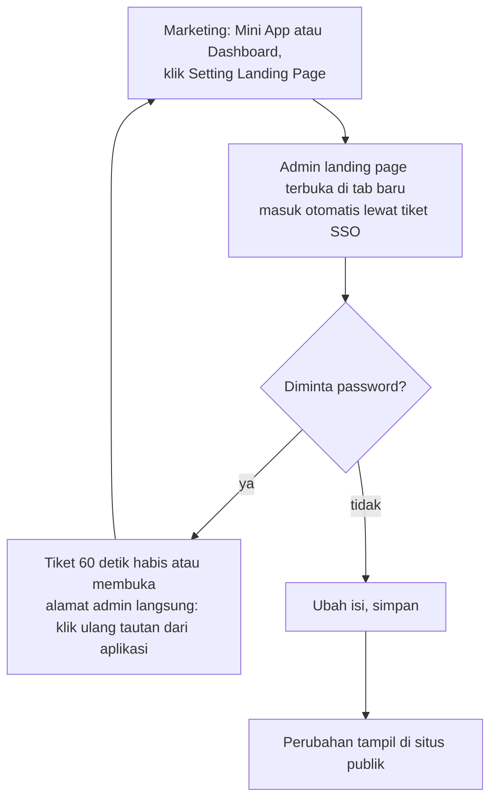
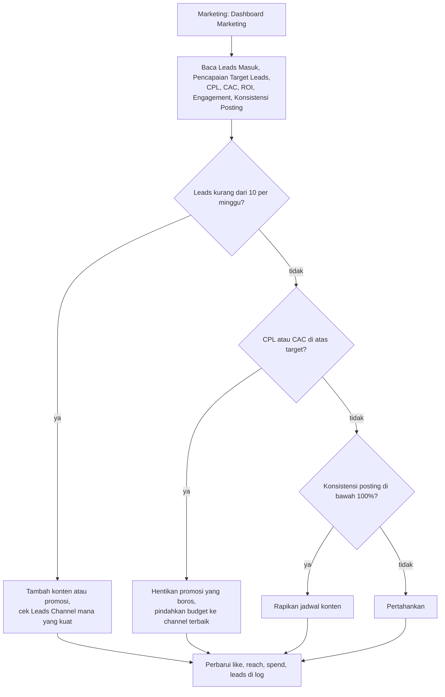
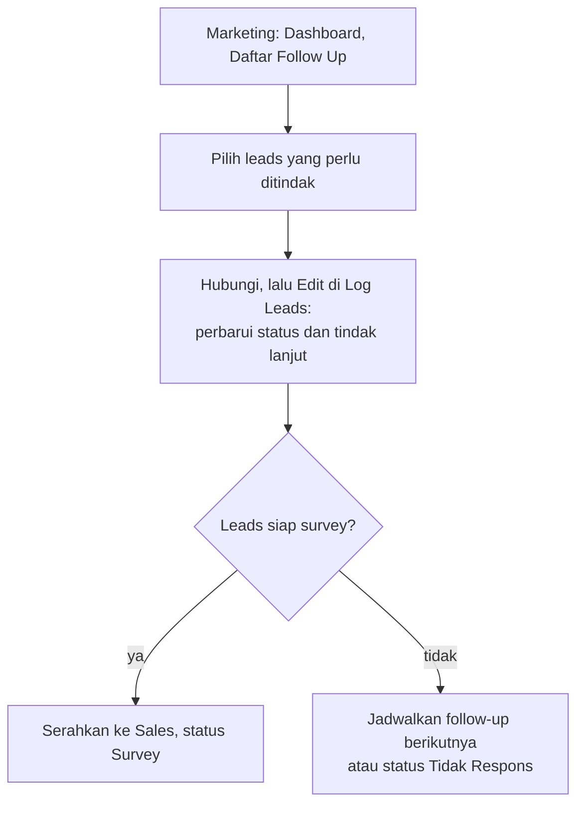
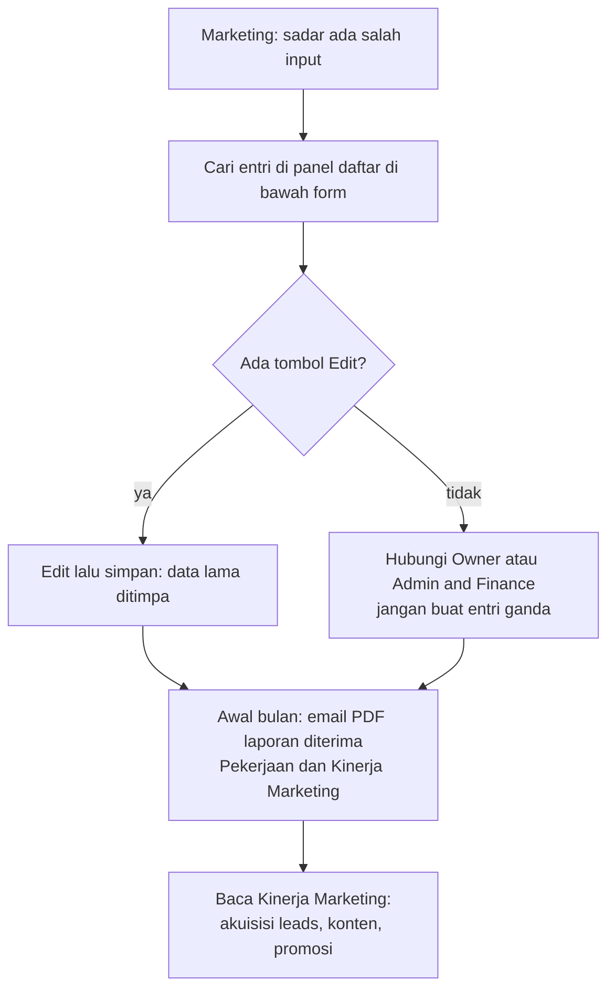

# Diagram Alir Kasus Operasional: Marketing

Peran: menciptakan leads dengan biaya terkendali. Tugas Marketing berhenti di leads. Survey dan seterusnya dihitung di Sales.

Aplikasi yang dipakai: **Mini App** (Log Leads Harian, Log Konten, Log Promosi, Tugas Harian, Setting Landing Page), **Dashboard** (Overview, Daftar Leads, Konten, Promosi, Dokumen, Target KPI). **Teman Rara**, **Inventory**, dan menu Laporan tidak dipakai Marketing; laporan sampai lewat email bulanan.

Cara membaca diagram: kotak = langkah, belah ketupat = keputusan. Nama di awal kotak menunjukkan siapa yang mengerjakan.

| No | Kasus | Aplikasi |
|---|---|---|
| K1 | Leads baru masuk | Mini App |
| K2 | Mempublikasikan konten | Mini App |
| K3 | Menjalankan promosi atau iklan | Mini App |
| K4 | Mengubah isi landing page | Mini App, Landing page |
| K5 | Evaluasi mingguan: leads kurang atau biaya mahal | Dashboard |
| K6 | Menindaklanjuti Daftar Follow Up | Dashboard, Mini App |
| K7 | Kesalahan input dan laporan bulanan | Mini App, Email |

---

## K1. Leads baru masuk

**Kapan terjadi:** calon penghuni menghubungi lewat WhatsApp, Instagram, iklan, atau situs. Target respons pertama paling lama 15 menit (dihitung dari waktu masuk).

**Checklist**
- [ ] Waktu masuk adalah waktu leads benar-benar masuk, bukan waktu mencatat.
- [ ] Waktu Chat Pertama boleh dikosongkan dulu, tapi harus diisi lewat Edit setelah chat terkirim.
- [ ] Tanpa dua waktu ini, Respons Leads Pertama tidak terhitung (tampil strip).

---

## K2. Mempublikasikan konten

**Kapan terjadi:** setiap konten yang tayang. Target konsistensi posting 100%.

**Perhatikan:** CAC bergantung pada biaya produksi konten, jadi jangan dikosongkan.

---

## K3. Menjalankan promosi atau iklan

**Kapan terjadi:** kampanye berbayar atau promo.

**Perhatikan:** target CPL paling tinggi Rp25.000, CAC paling tinggi Rp50.000, ROI promosi 100%.

---

## K4. Mengubah isi landing page

**Kapan terjadi:** foto kamar, teks, promo di situs publik perlu diubah.

**Perhatikan:** klik tautan hanya saat siap masuk, karena tiketnya berlaku 60 detik. Hanya Owner dan Marketing yang punya tautan ini.

---

## K5. Evaluasi mingguan: leads kurang atau biaya mahal

**Kapan terjadi:** tiap minggu.

---

## K6. Menindaklanjuti Daftar Follow Up

**Kapan terjadi:** Dashboard menampilkan Daftar Follow Up.

---

## K7. Kesalahan input dan laporan bulanan

**Kapan terjadi:** salah isi form, atau awal bulan saat laporan terbit.

---

## Ringkasan: kasus, KPI, dan target

| Kasus | KPI | Target |
|---|---|---|
| K1 | Leads masuk | Minimal 10 per minggu |
| K1 | Respons leads pertama (Sales ikut) | Paling lama 15 menit |
| K3 | Pencapaian target leads | 80% |
| K3 | CPL | Paling tinggi Rp25.000 |
| K2, K3 | CAC | Paling tinggi Rp50.000 |
| K3 | ROI promosi | 100% |
| K2 | Engagement rate | 70% |
| K2 | Konsistensi posting | 100% |
