# Diagram Alir Kasus Operasional: Operasional

Peran: menjaga kamar dan fasilitas layak huni. Satu role mencakup **Maintenance, Inspeksi, dan Cleaning**.

Aplikasi yang dipakai: **Mini App** (form perawatan, perbaikan, inspeksi, work order, Kamar Siap Sewa, Pemakaian Stok, Tambah Vendor, Kecelakaan Kerja, Tugas Harian, Pre-Check In dan Pre-Check Out, Status Kamar, Joblist di Beranda), **Dashboard** (Overview, Daftar Tiket, Daftar Vendor, Stok Inventory, Data Kamar, Dokumen, Target KPI), **Inventory Stock** (Dashboard, Daftar Bahan, Daftar Alat, Pembelian, Pemakaian). **Teman Rara** tidak punya panel untuk Operasional; pengaduan penghuni sampai ke Operasional lewat Admin and Finance (K8).

Cara membaca diagram: kotak = langkah, belah ketupat = keputusan. Nama di awal kotak menunjukkan siapa yang mengerjakan.

| No | Kasus | Aplikasi |
|---|---|---|
| K1 | Siklus status kamar: Kosong, Booking, Terisi, Maintenance | Mini App |
| K2 | Kerusakan dilaporkan: Perbaikan Korektif | Mini App |
| K3 | Perawatan terjadwal: Preventif | Mini App |
| K4 | Inspeksi harian dan temuan | Mini App |
| K5 | Work order: mengirim dan menerima | Mini App |
| K6 | Penghuni baru akan masuk: Pre-Check In | Mini App |
| K7 | Penghuni keluar: Pre-Check Out sampai Kamar Siap Sewa | Mini App |
| K8 | Pengaduan penghuni tentang kerusakan | Teman Rara, Mini App |
| K9 | Menandai kamar Maintenance dengan tombol | Mini App |
| K10 | Pemakaian stok, stok menipis, dan opname | Mini App, Inventory |
| K11 | Vendor dan kecelakaan kerja | Mini App |
| K12 | Evaluasi mingguan KPI Operasional | Dashboard |

---

## K1. Siklus status kamar: Kosong, Booking, Terisi, Maintenance

**Kapan terjadi:** selalu. Memahami siklus ini menjelaskan kenapa sebuah kamar tidak bisa dibooking atau tidak berubah.

Siklus normal (tanpa Maintenance):

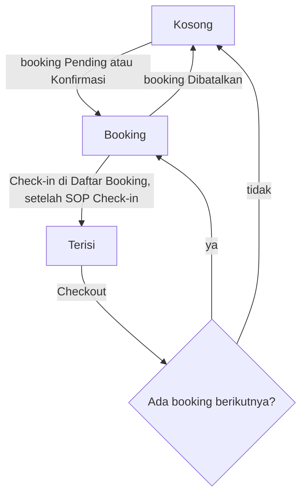

Masuk dan keluar Maintenance (dari status mana pun):

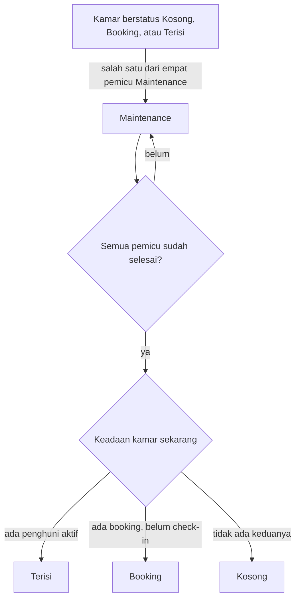

**Empat pemicu Maintenance** (kamar kembali hanya setelah **semua** pemicunya selesai):

| Pemicu | Memasang | Melepas |
|---|---|---|
| Tombol di menu Status Kamar | Tandai Maintenance, alasan wajib | Selesai Maintenance (menutup semua pemicu kamar itu) |
| Pengaduan Teman Rara (hanya penghuni aktif) | Komplain Listrik, Air, AC, atau Fasilitas diubah ke Diproses | Selesai, Dibatalkan, atau kembali Menunggu |
| Inspeksi checkout (Pre-Check Out) | Ada item Rusak atau Perlu Perbaikan | Kamar Siap Sewa diisi, atau inspeksi dikirim ulang semua Baik |
| Work order tujuan Maintenance | Kolom Kamar diisi | Work order Complete |

**Perhatikan:** kamar Booking dan Maintenance tidak muncul di pilihan booking baru. Checkout tidak mengubah kamar Maintenance menjadi Kosong selama masih ada pemicu terbuka.

---

## K2. Kerusakan dilaporkan: Perbaikan Korektif

**Kapan terjadi:** ada kerusakan yang harus diperbaiki (dari temuan sendiri atau laporan). SLA tiket saat ini 3 hari, Resolution Time paling lama 1 hari.

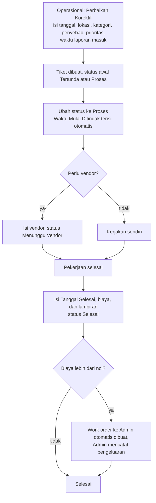

**Checklist**
- [ ] Tanggal Selesai diisi begitu tuntas. Tiket tanpa tanggal selesai dianggap belum selesai dan tidak masuk Resolution Time.
- [ ] Kasus berulang di lokasi yang sama diberi perbaikan permanen. Tiket Berulang paling banyak 2 kasus.
- [ ] Bila kerusakan membuat kamar tidak layak dipakai, tandai kamar Maintenance (K9 atau lewat work order berkamar, K5).

---

## K3. Perawatan terjadwal: Preventif

**Kapan terjadi:** jadwal servis AC, pompa, listrik, dan fasilitas lain.

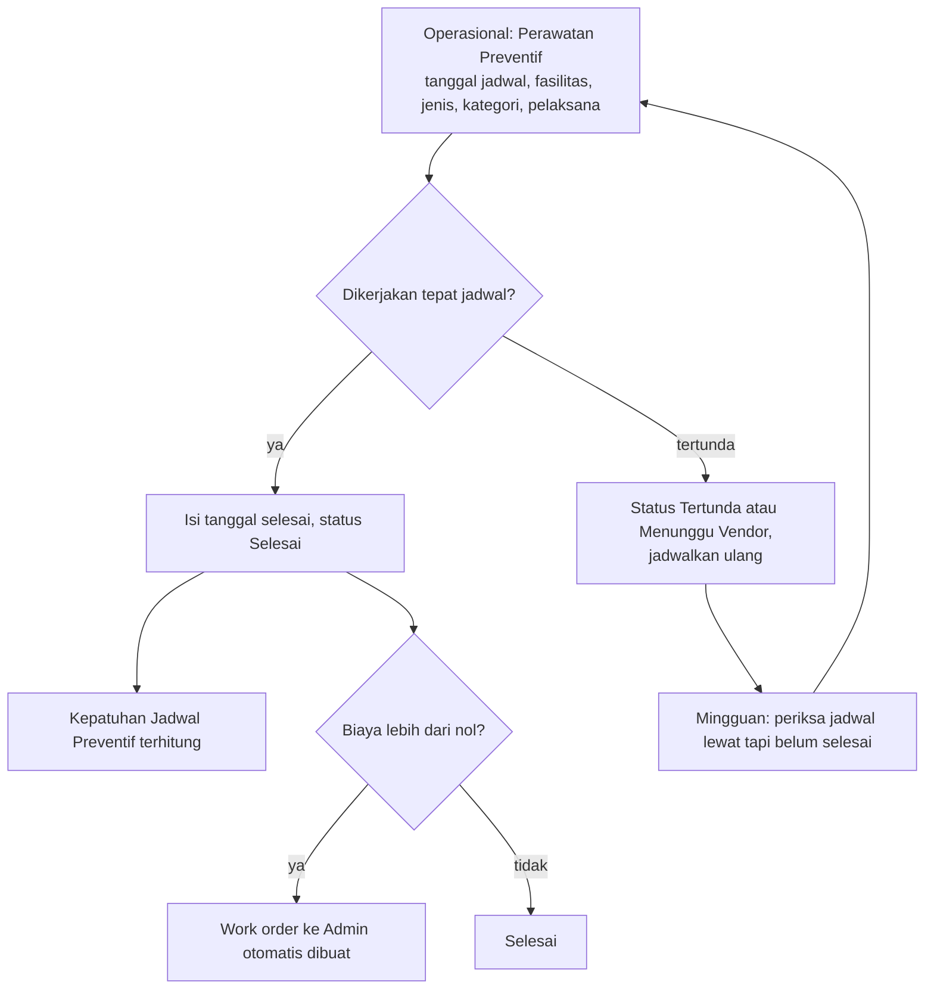

**Perhatikan:** target Kepatuhan Jadwal Preventif 100%.

---

## K4. Inspeksi harian dan temuan

**Kapan terjadi:** setiap hari. Satu inspeksi per hari sudah membuat hari itu dihitung patuh.

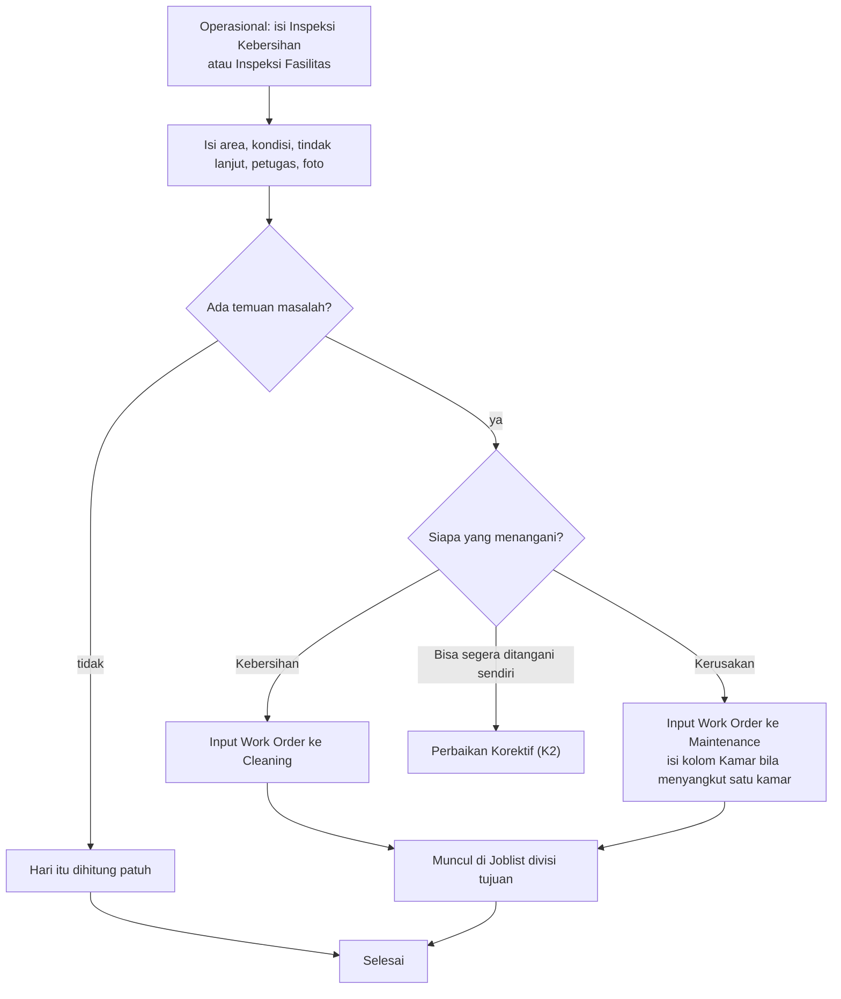

**Perhatikan:** target Kepatuhan Inspeksi Harian 100%. Dihitung dari jumlah hari yang punya inspeksi.

---

## K5. Work order: mengirim dan menerima

**Kapan terjadi:** ada pekerjaan yang harus dikerjakan sub-divisi lain (Inspeksi ke Cleaning atau Maintenance, Cleaning ke Maintenance atau Inspeksi), atau Anda menerima pekerjaan di Joblist.

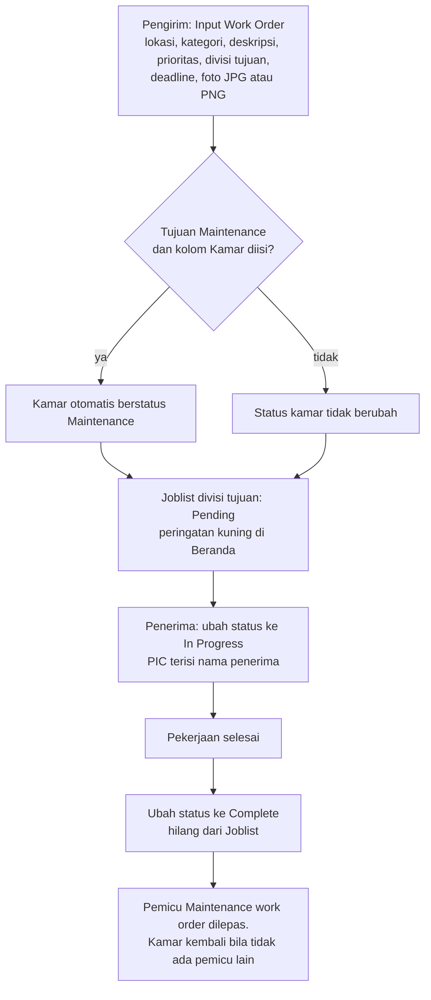

**Checklist**
- [ ] Prioritas sesuai: Rendah, Sedang, Tinggi, Darurat.
- [ ] Kolom Kamar kosong untuk area umum (tidak mengubah status kamar).
- [ ] Hanya staf divisi tujuan yang bisa mengubah status. Owner dan Pengawas hanya melihat.

---

## K6. Penghuni baru akan masuk: Pre-Check In

**Kapan terjadi:** booking sudah Konfirmasi dan penghuni akan masuk.

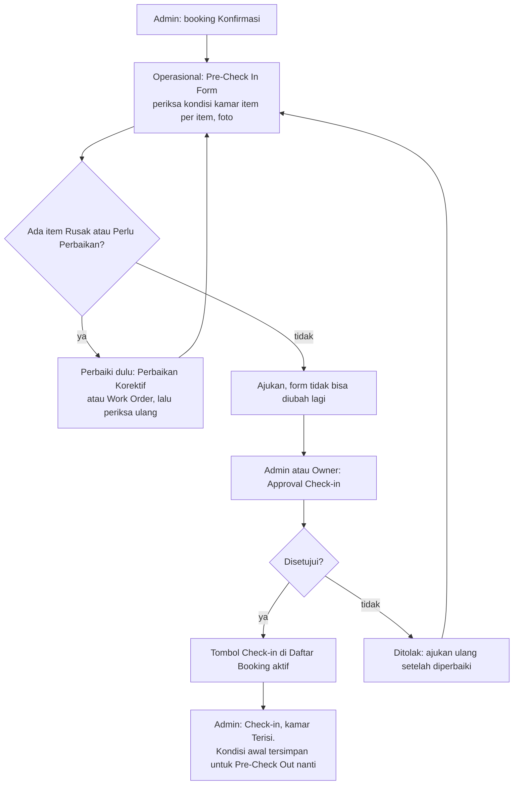

**Perhatikan:** form tidak bisa diubah setelah diajukan, jadi periksa teliti sebelum klik. Kondisi awal ini menjadi pembanding saat penghuni keluar.

---

## K7. Penghuni keluar: Pre-Check Out sampai Kamar Siap Sewa

**Kapan terjadi:** penghuni mengajukan checkout dan sudah disetujui Admin and Finance.

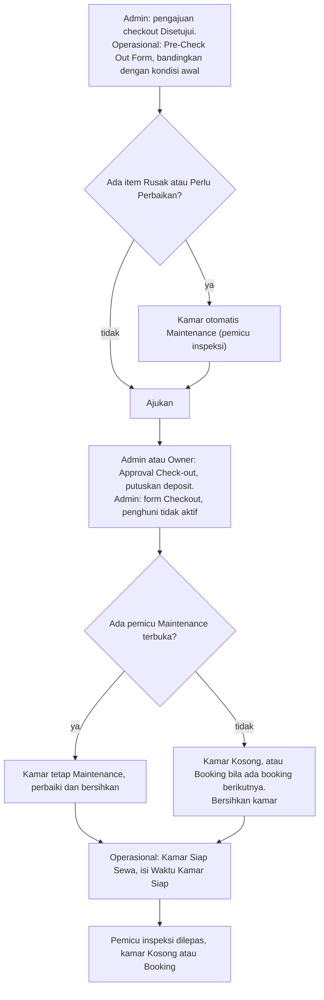

**Checklist**
- [ ] Waktu Kamar Siap diisi begitu kamar siap. Waktu Prepare Kamar dihitung dari checkout sampai waktu ini (target paling lama 1 hari).
- [ ] Yang muncul di pilihan Kamar Siap hanya checkout yang belum ditandai siap.
- [ ] Temuan kerusakan diteruskan ke Perbaikan Korektif atau Work Order agar ada jejak biayanya.

---

## K8. Pengaduan penghuni tentang kerusakan

**Kapan terjadi:** penghuni aktif mengirim pengaduan Listrik, Air, AC, atau Fasilitas lewat Teman Rara.

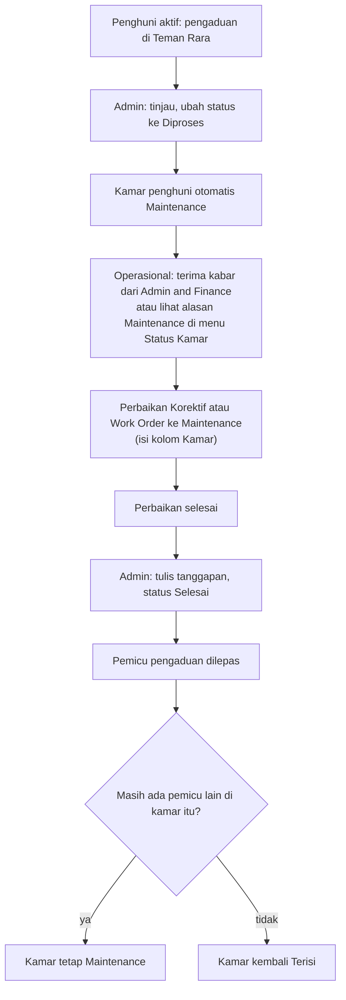

**Perhatikan:** pengaduan dari penghuni yang sudah tidak aktif tidak mengubah status kamar. Operasional tidak punya panel Teman Rara, jadi koordinasi dengan Admin and Finance penting. Pengaduan non-kerusakan (kebersihan, keamanan, pelayanan) tidak memasang Maintenance.

---

## K9. Menandai kamar Maintenance dengan tombol

**Kapan terjadi:** kamar perlu direnovasi atau dikosongkan untuk pekerjaan yang tidak punya tiket, pengaduan, atau work order.

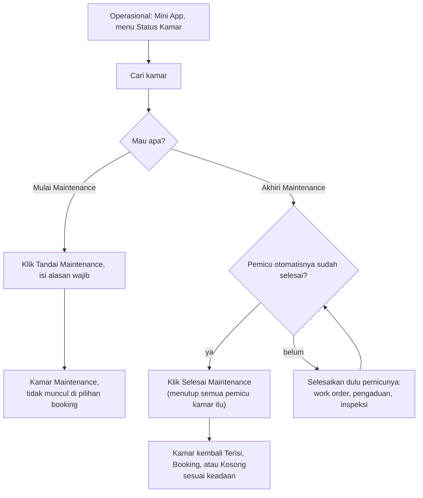

**Perhatikan:** tombol Selesai menutup semua pemicu, termasuk yang otomatis. Pakai hanya bila pekerjaannya benar-benar beres. Semua perubahan tercatat (siapa dan kapan).

---

## K10. Pemakaian stok, stok menipis, dan opname

**Kapan terjadi:** setiap kali bahan dipakai.

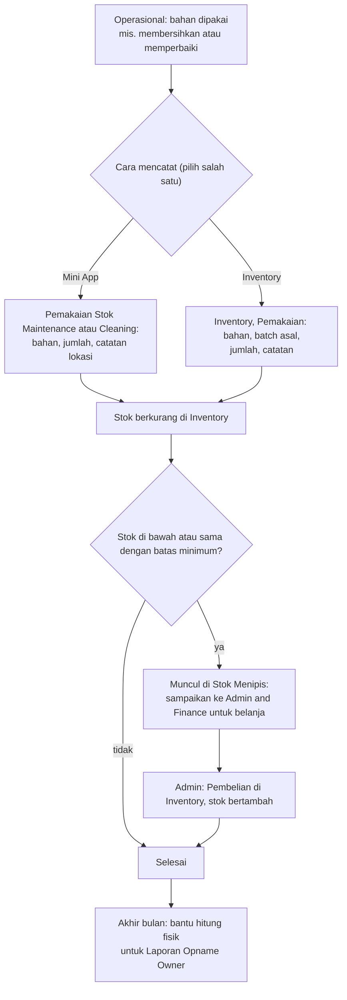

**Perhatikan:** jangan mencatat pemakaian yang sama di kedua tempat. Pemakaian tanpa batch dicatat tanpa biaya.

---

## K11. Vendor dan kecelakaan kerja

**Kapan terjadi:** butuh vendor baru, atau terjadi kecelakaan saat bekerja.

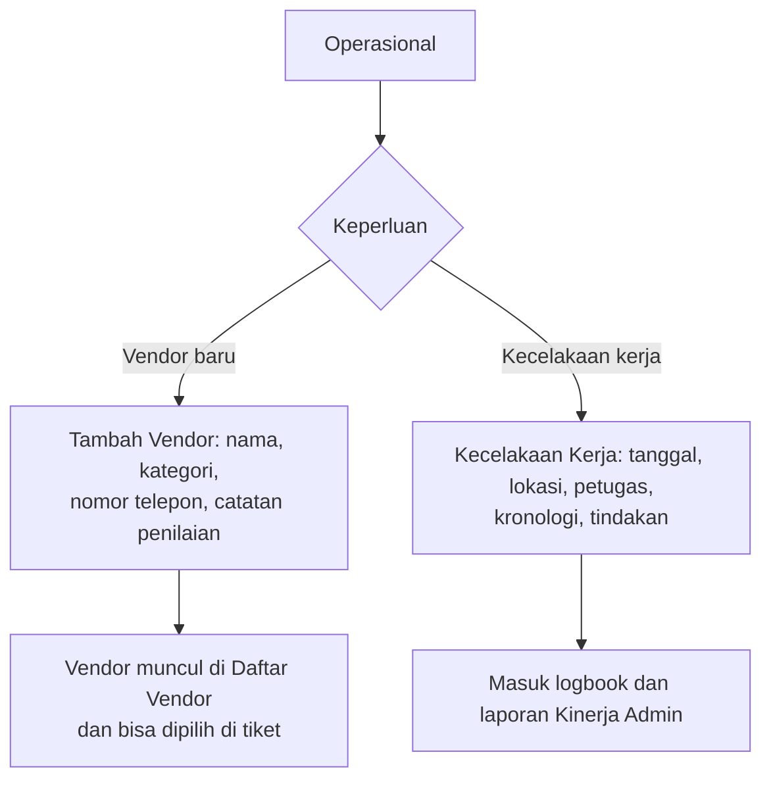

---

## K12. Evaluasi mingguan KPI Operasional

**Kapan terjadi:** tiap minggu dan awal bulan.

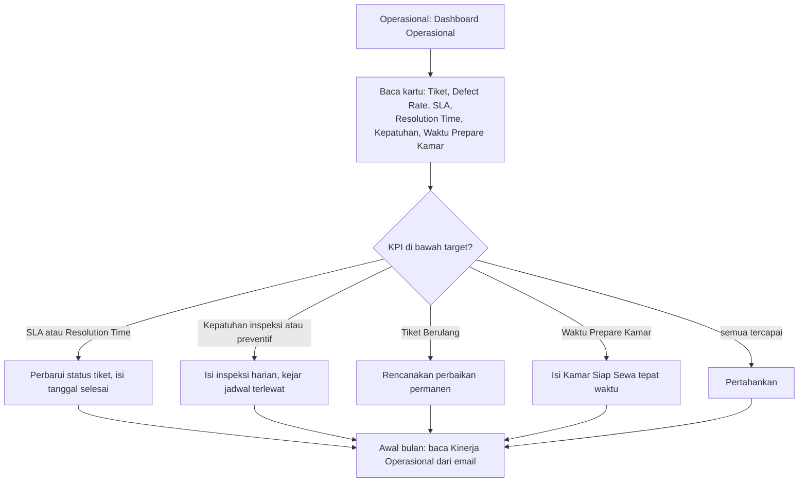

---

## Ringkasan: kasus, KPI, dan target

| Kasus | KPI | Target |
|---|---|---|
| K2 | Kepatuhan SLA tiket | 100% (SLA saat ini 3 hari) |
| K2 | Resolution time | Paling lama 1 hari |
| K2, K12 | Tiket berulang | Paling banyak 2 kasus |
| K2, K3 | Biaya perbaikan per kamar | Paling tinggi Rp150.000 |
| K3 | Kepatuhan jadwal preventif | 100% |
| K4 | Kepatuhan inspeksi harian | 100% |
| K7 | Waktu prepare kamar | Paling lama 1 hari |
