# Diagram Alir Kasus Operasional: Owner

Peran: memantau seluruh kost, memegang keputusan yang tidak dipegang role lain (harga kamar, akun dan role, penerima laporan, koreksi stok), dan menjadi cadangan persetujuan.

Aplikasi yang dipakai: **Dashboard** (semua halaman), **Mini App** (semua form dan menu), **Inventory Stock** (semua menu), **Teman Rara** (dikelola lewat panel di Mini App).

Cara membaca diagram: kotak = langkah, belah ketupat = keputusan, panah berlabel = pilihan. Nama di awal kotak (mis. "Admin:") menunjukkan siapa yang mengerjakan.

| No | Kasus | Aplikasi |
|---|---|---|
| K1 | Staf baru mendaftar akun | Mini App, Dashboard |
| K2 | Pantauan harian dan angka yang janggal | Dashboard |
| K3 | Mengubah harga kamar | Mini App |
| K4 | Menggantikan persetujuan saat Admin and Finance berhalangan | Mini App |
| K5 | Peringatan kuning di Beranda | Mini App, Teman Rara |
| K6 | Menerbitkan pengumuman ke penghuni | Mini App, Teman Rara |
| K7 | Salah catat pembayaran: void atau koreksi | Mini App |
| K8 | Siklus laporan bulanan dan Owner Review | Mini App, Dashboard |
| K9 | Mengatur target KPI dan kepala divisi | Dashboard |
| K10 | Opname stok akhir bulan dan selisih stok | Inventory |
| K11 | Memeriksa status kamar | Mini App, Dashboard |

---

## K1. Staf baru mendaftar akun

**Kapan terjadi:** ada karyawan baru atau staf yang akunnya belum aktif (layar "Menunggu Persetujuan").

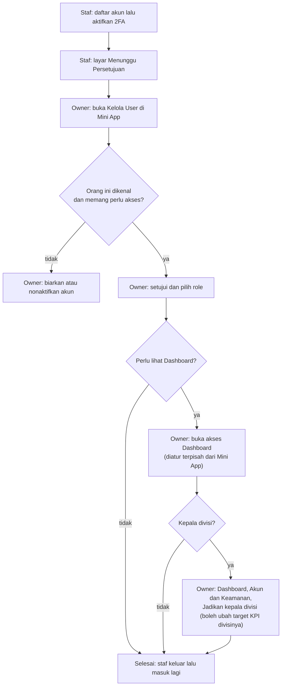

**Checklist**
- [ ] Role sesuai tugas (Admin and Finance, Sales, Marketing, Operasional, Pengawas).
- [ ] Akses Dashboard dibuka kalau staf perlu melihat angka.
- [ ] Staf sudah scan 2FA (satu kali berlaku untuk Dashboard dan Mini App).

**Perhatikan:** Pengawas hanya ada di Dashboard dan tidak punya akses Mini App. Staf yang bisa masuk Mini App tapi ditolak Dashboard hampir selalu belum dibukakan akses Dashboard.

---

## K2. Pantauan harian dan angka yang janggal

**Kapan terjadi:** setiap hari, atau saat angka di Overview terasa tidak masuk akal.

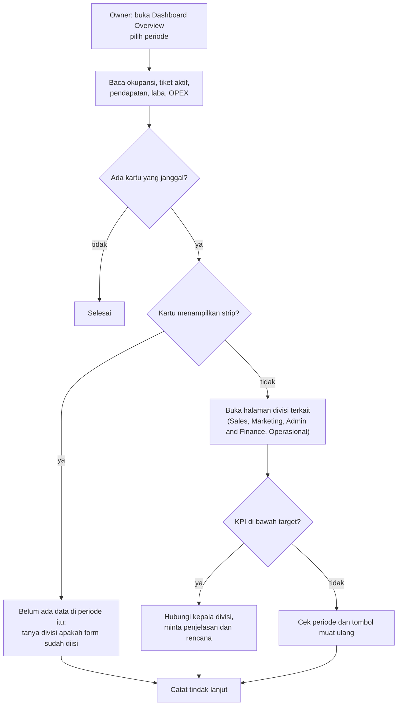

**Checklist**
- [ ] Periode yang dipilih benar (bawaan: Tahun ini).
- [ ] Strip diperlakukan sebagai "belum ada data", bukan nol.
- [ ] Temuan dicatat dan ditindaklanjuti di rapat mingguan.

---

## K3. Mengubah harga kamar

**Kapan terjadi:** penyesuaian tarif per tipe kamar atau per durasi sewa. Hanya Owner yang bisa.

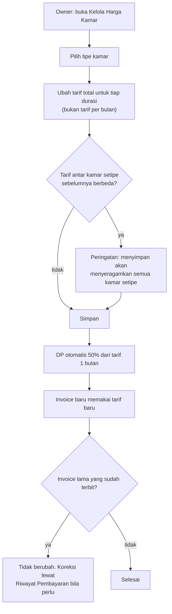

**Checklist**
- [ ] Angka yang dimasukkan adalah total untuk seluruh durasi.
- [ ] Admin and Finance diberi tahu tanggal berlaku tarif baru.
- [ ] Harga yang disepakati di booking wajar terhadap tarif (sistem menolak harga kurang dari 50% atau lebih dari 200% tarif).

---

## K4. Menggantikan persetujuan saat Admin and Finance berhalangan

**Kapan terjadi:** Approval Check-in, Approval Check-out, atau pengajuan checkout menunggu terlalu lama.

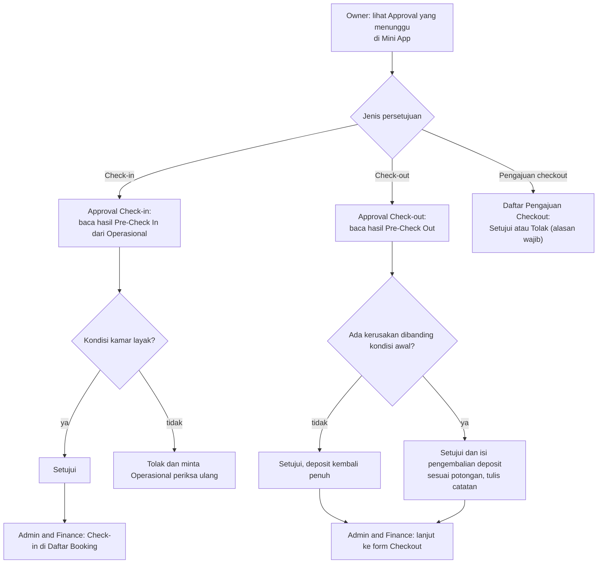

**Perhatikan:** nominal deposit dibaca sistem dari database, sehingga pengembalian tidak bisa melebihi deposit asli.

---

## K5. Peringatan kuning di Beranda

**Kapan terjadi:** Beranda Mini App menampilkan pengajuan checkout yang menunggu atau pengaduan yang belum selesai.

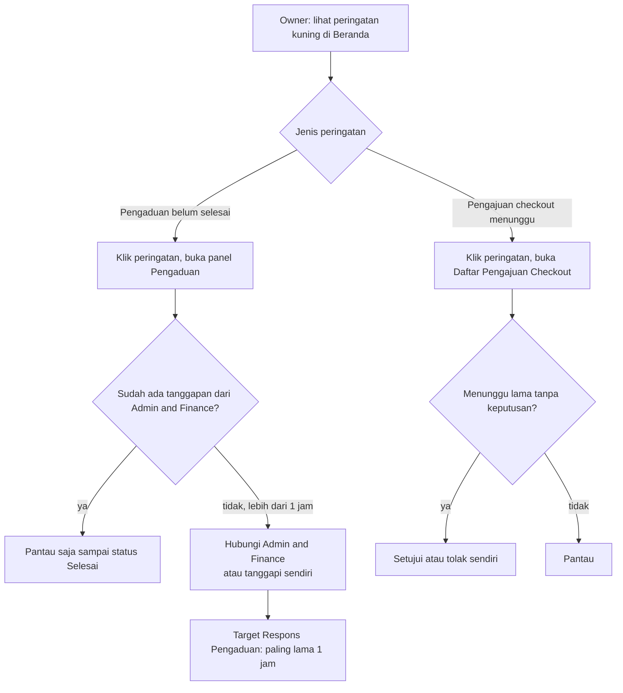

**Perhatikan:** angka peringatan yang tinggi dan lama tidak turun menandakan penanganan terlambat. Itu bahan evaluasi mingguan.

---

## K6. Menerbitkan pengumuman ke penghuni

**Kapan terjadi:** perubahan peraturan, pemadaman, atau informasi umum. Owner boleh menerbitkan bila Admin and Finance berhalangan.

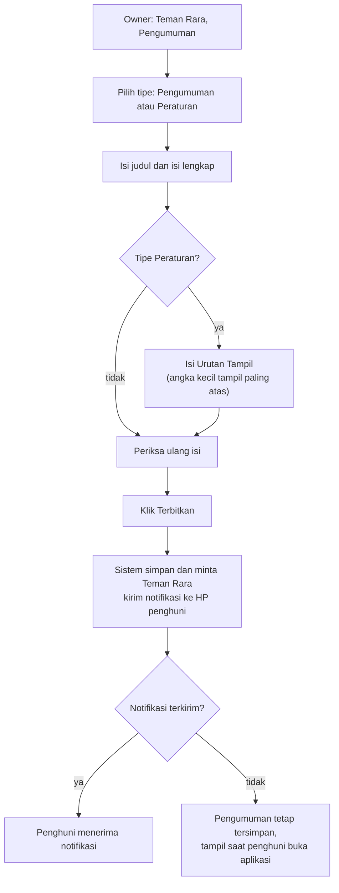

**Perhatikan:** pengumuman Owner ikut mengirim notifikasi ke HP seluruh penghuni, jadi baca ulang sebelum klik Terbitkan. Mengubah isi hanya mengirim notifikasi baru kalau judul atau isinya benar-benar berubah.

---

## K7. Salah catat pembayaran: void atau koreksi

**Kapan terjadi:** nominal, penghuni, atau periode salah; atau pembayaran memang batal. Prinsipnya: catatan keuangan tidak dihapus.

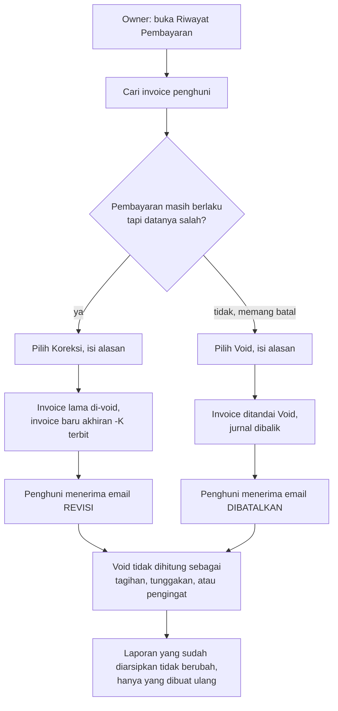

**Checklist**
- [ ] Alasan diisi jelas (wajib).
- [ ] Bukti transfer yang salah tautan dilepas dari invoice (berkas di Drive tidak terhapus).
- [ ] Laporan bulan itu dibuat ulang bila angkanya sudah diarsipkan.

---

## K8. Siklus laporan bulanan dan Owner Review

**Kapan terjadi:** tiap awal bulan.

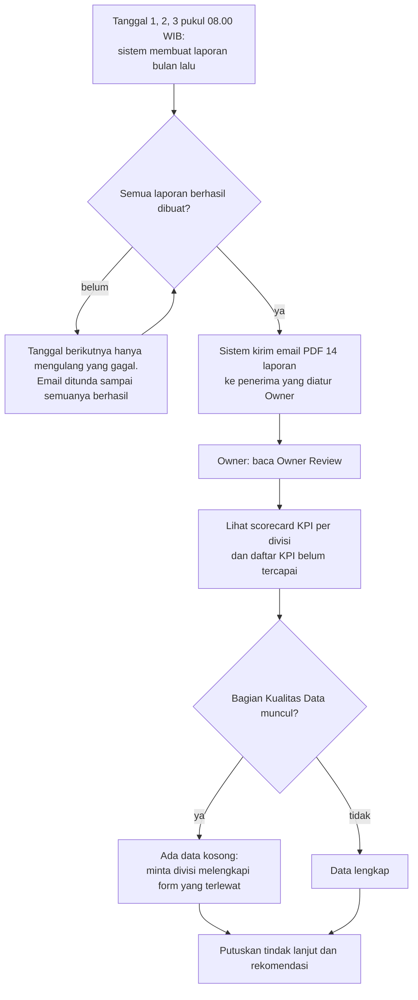

**Checklist awal bulan**
- [ ] Email penerima laporan masih benar (panel Email Tujuan di bagian atas halaman Laporan, maksimal 10 alamat).
- [ ] Owner Review dibaca. Hanya Owner yang bisa membuat dan melihatnya.
- [ ] Bulan berjalan belum bisa di-Generate & Arsipkan, hanya Pratinjau dan Unduh PDF.

---

## K9. Mengatur target KPI dan kepala divisi

**Kapan terjadi:** SOW divisi berubah atau target perlu disesuaikan.

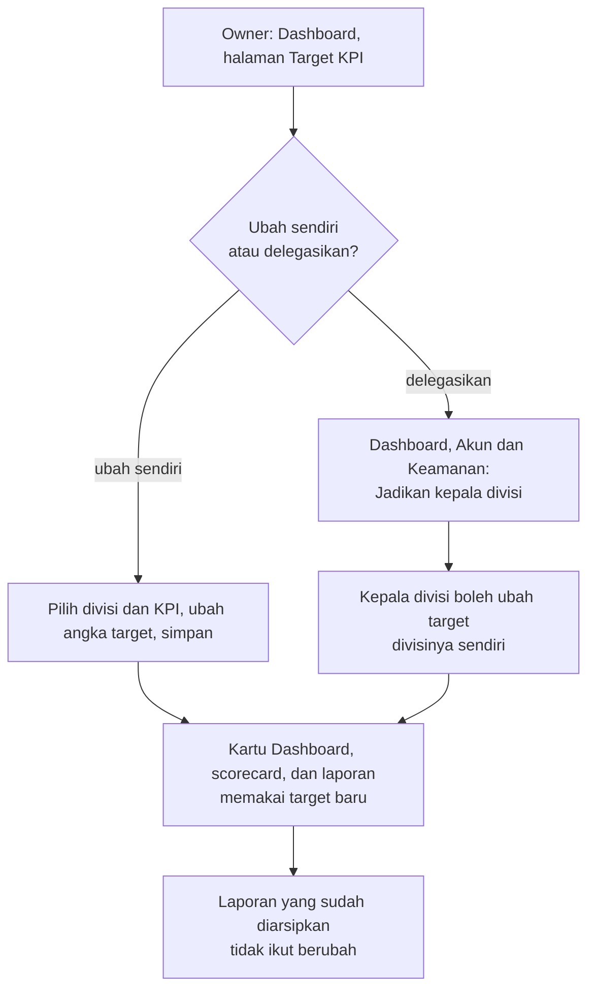

---

## K10. Opname stok akhir bulan dan selisih stok

**Kapan terjadi:** akhir bulan, atau stok di sistem tidak sama dengan hitungan fisik. Pembelian dan pemakaian sehari-hari dikerjakan Admin and Finance dan Operasional.

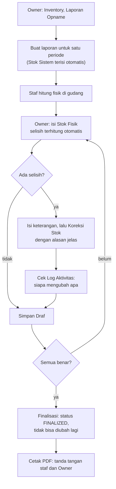

**Perhatikan:** hanya Owner yang bisa menambah atau mengubah bahan dan alat, Koreksi Stok, Laporan Opname, dan Log Aktivitas.

---

## K11. Memeriksa status kamar

**Kapan terjadi:** ingin tahu kenapa kamar tidak bisa dibooking, atau status kamar tidak cocok dengan kenyataan.

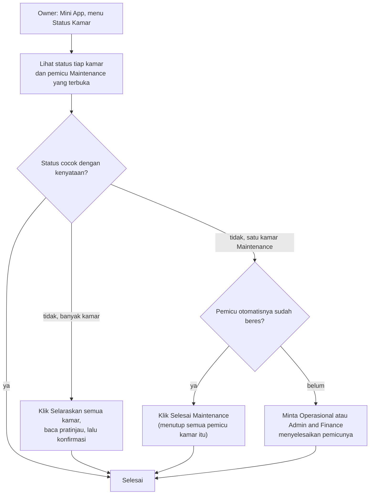

---

## Ringkasan: kasus, siapa terlibat, dan KPI yang dipantau

| Kasus | Role lain yang terlibat | KPI Owner yang terpengaruh |
|---|---|---|
| K1 | Staf baru | (akses) |
| K2 | Semua divisi | Pendapatan Rp26 juta per bulan, laba Rp15 juta, okupansi 100% |
| K3 | Admin and Finance | Pendapatan, RevPAR, margin |
| K4, K5 | Admin and Finance, Operasional | Kepuasan penghuni, respons pengaduan |
| K7 | Admin and Finance | Pendapatan, laba |
| K8, K9 | Semua kepala divisi | Seluruh KPI |
| K10 | Admin and Finance, Operasional | OPEX per kamar paling tinggi Rp300 ribu |
| K11 | Operasional | Kamar kosong 0, okupansi |
