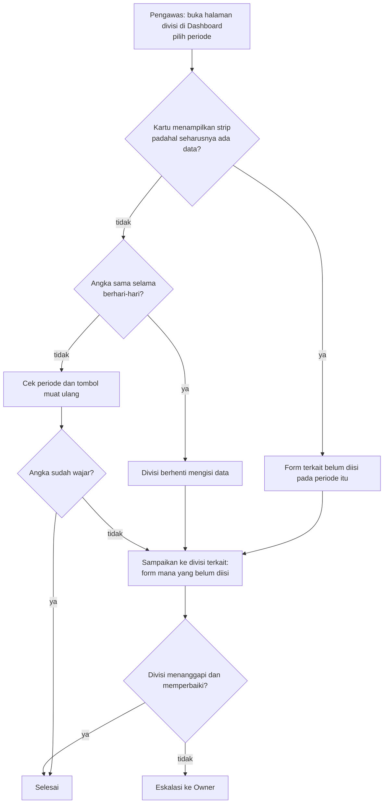
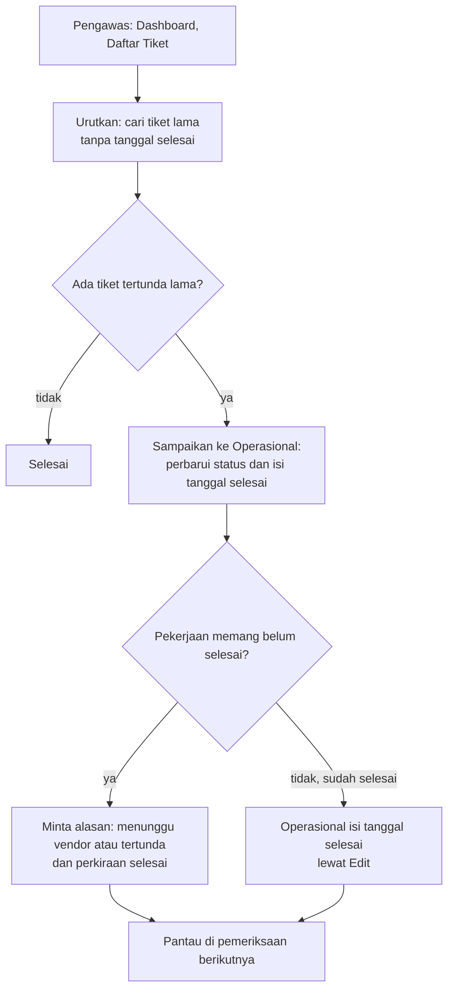
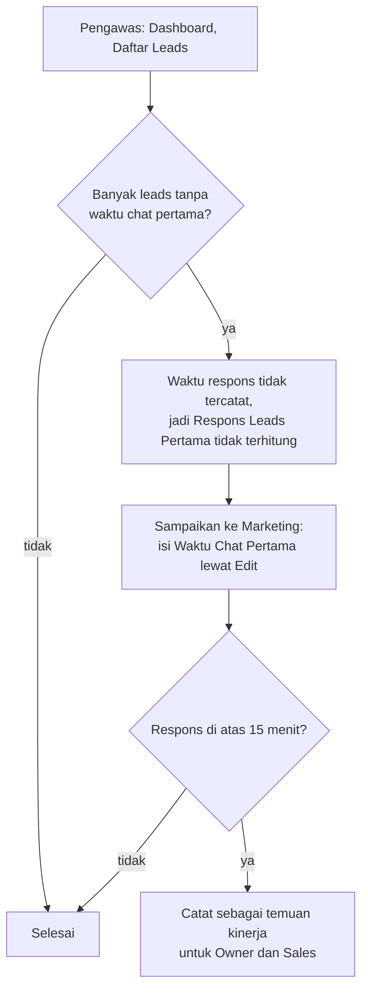
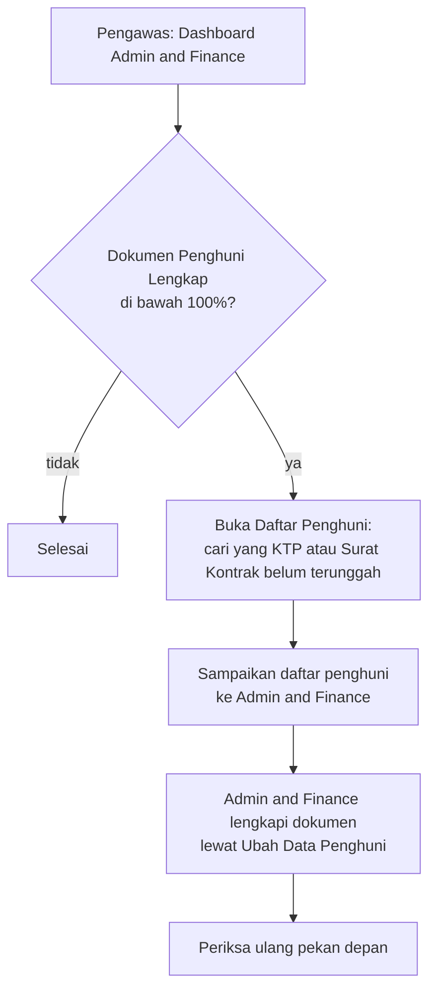
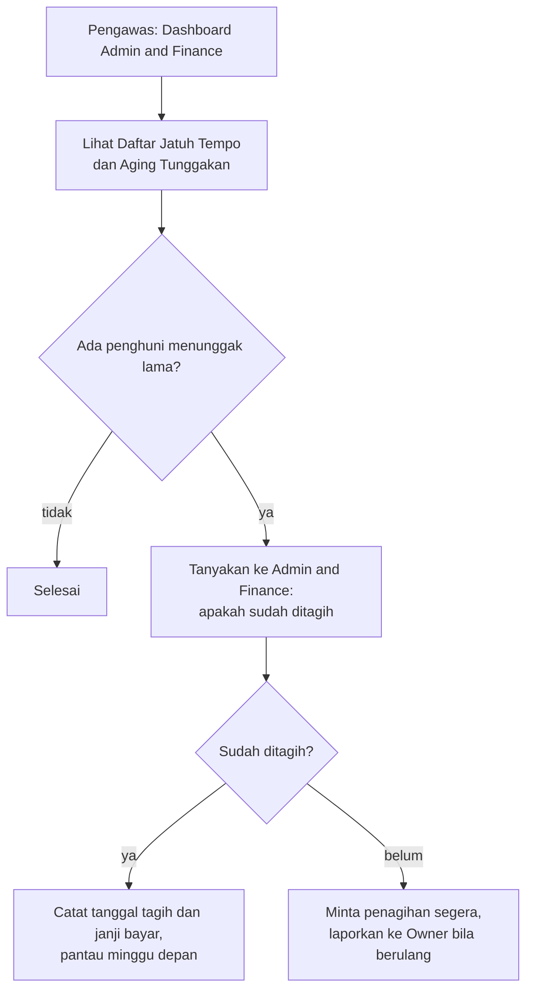
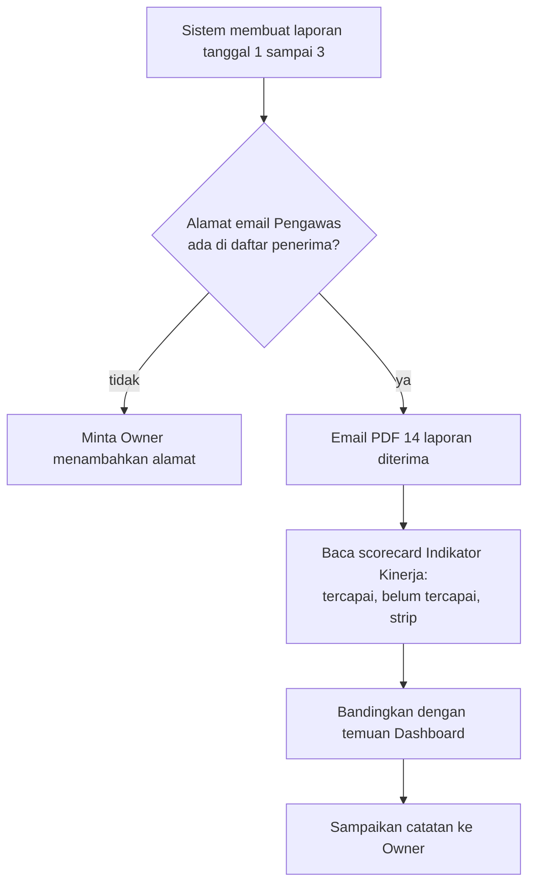

# Diagram Alir Kasus Operasional: Pengawas

Peran: membaca semua halaman Dashboard seperti Owner untuk memeriksa apakah divisi mengisi data dan apakah angka masuk akal. Pengawas **tidak punya akses Mini App dan Inventory**, tidak mengisi data, dan tidak punya menu Laporan.

Aplikasi yang dipakai: **Dashboard** (baca saja, data pribadi penghuni tampil utuh). Teman Rara, Mini App, dan Inventory tidak bisa dibuka; hasilnya dilihat dari angka di Dashboard.

Cara membaca diagram: kotak = langkah, belah ketupat = keputusan. Temuan Pengawas selalu berakhir sebagai pesan ke divisi terkait atau Owner.

| No | Kasus | Aplikasi |
|---|---|---|
| K1 | Pemeriksaan rutin: kartu strip atau angka tidak bergerak | Dashboard |
| K2 | Tiket maintenance tanpa tanggal selesai | Dashboard |
| K3 | Leads tanpa waktu chat pertama | Dashboard |
| K4 | Dokumen penghuni belum lengkap | Dashboard |
| K5 | Jatuh tempo dan tunggakan tidak ditagih | Dashboard |
| K6 | Menerima laporan bulanan lewat email | Email |

---

## K1. Pemeriksaan rutin: kartu strip atau angka tidak bergerak

**Kapan terjadi:** pemeriksaan mingguan, atau saat satu kartu terasa aneh.

**Checklist**
- [ ] Strip dibaca sebagai "belum ada data", bukan nol.
- [ ] Periode yang dipilih sudah benar sebelum menuduh divisi.
- [ ] Temuan disebutkan spesifik (kartu mana, periode mana).

---

## K2. Tiket maintenance tanpa tanggal selesai

**Kapan terjadi:** Daftar Tiket berisi tiket lama yang tidak pernah selesai.

**Perhatikan:** tiket tanpa tanggal selesai dianggap belum selesai dan tidak masuk hitungan Resolution Time. SLA tiket saat ini 3 hari.

---

## K3. Leads tanpa waktu chat pertama

**Kapan terjadi:** kartu Respons Leads Pertama kosong atau jelek.

---

## K4. Dokumen penghuni belum lengkap

**Kapan terjadi:** kartu Dokumen Penghuni Lengkap di bawah 100%.

---

## K5. Jatuh tempo dan tunggakan tidak ditagih

**Kapan terjadi:** Daftar Jatuh Tempo berisi penghuni yang belum bayar.

**Perhatikan:** target penghuni menunggak paling banyak 2 dan Collection Rate 100%. Nominal tunggakan adalah perkiraan dari satu tagihan bulanan terakhir.

---

## K6. Menerima laporan bulanan lewat email

**Kapan terjadi:** awal bulan, bila alamat email Pengawas sudah dimasukkan Owner ke daftar penerima.

**Perhatikan:** Pengawas tidak punya menu Laporan di aplikasi, hanya menerima lewat email.

---

## Ringkasan: tanda, artinya, dan siapa dihubungi

| Tanda di Dashboard | Kemungkinan artinya | Dihubungi |
|---|---|---|
| Kartu strip padahal seharusnya ada data | Form belum diisi | Divisi terkait |
| Angka tidak bergerak berhari-hari | Divisi berhenti mengisi | Divisi terkait, lalu Owner |
| Tiket tanpa tanggal selesai lama | Status tiket tidak diperbarui | Operasional |
| Leads tanpa waktu chat pertama | Waktu respons tidak dicatat | Marketing |
| Dokumen Penghuni Lengkap di bawah 100% | KTP atau Surat Kontrak belum terunggah | Admin and Finance |
| Daftar Jatuh Tempo berisi yang belum bayar | Penagihan belum jalan | Admin and Finance |
