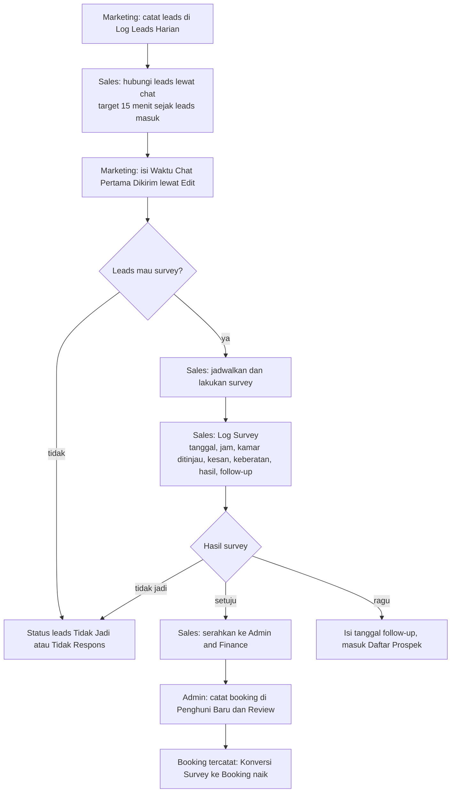
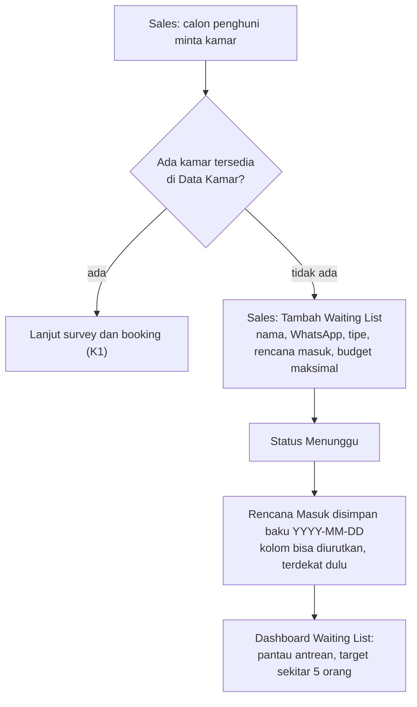
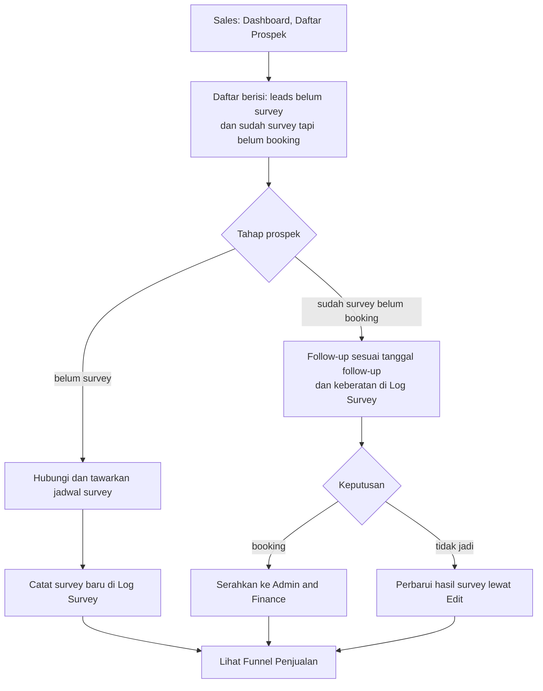
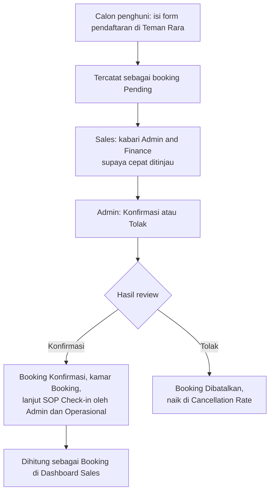
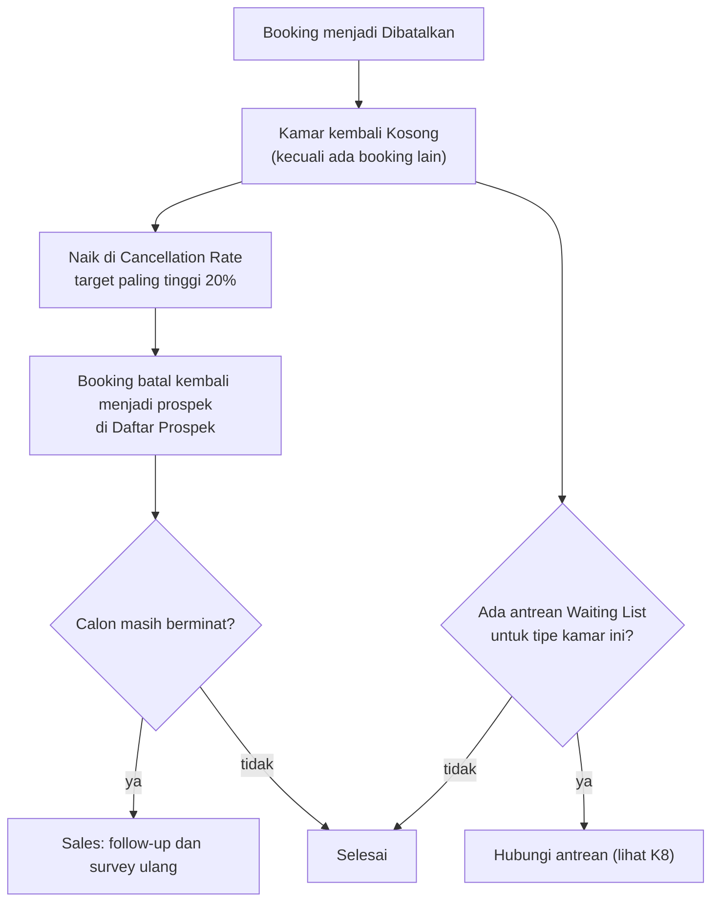
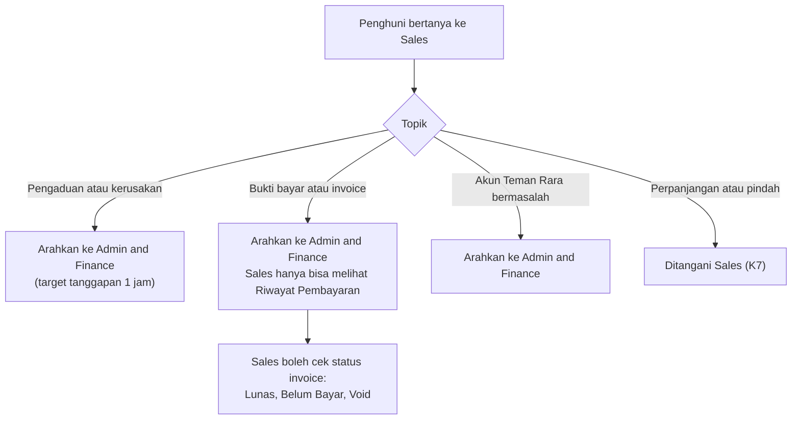
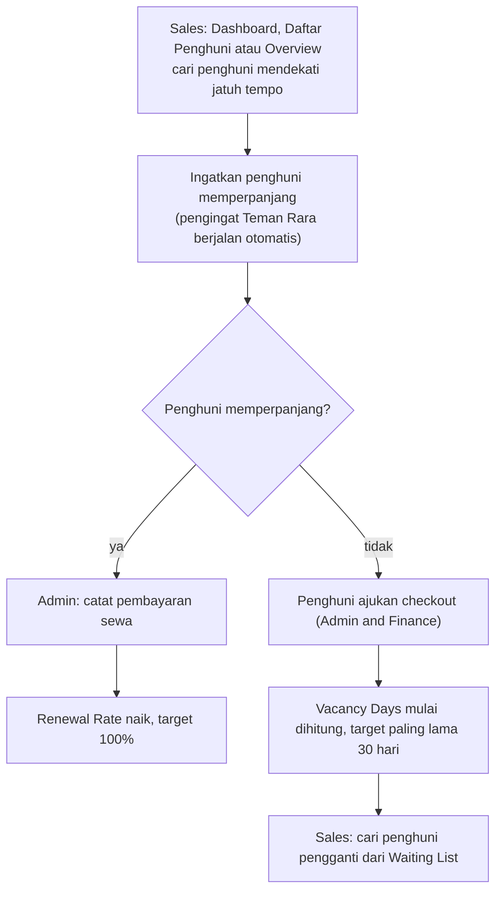
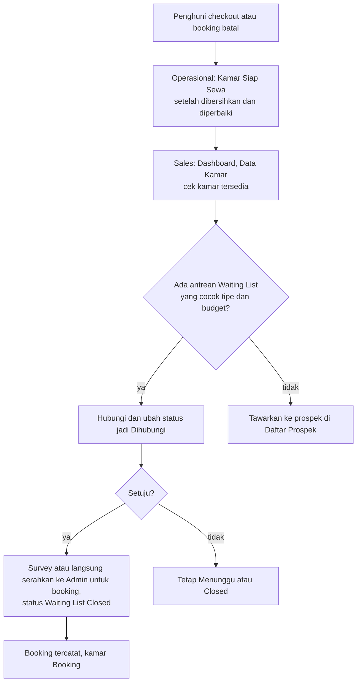
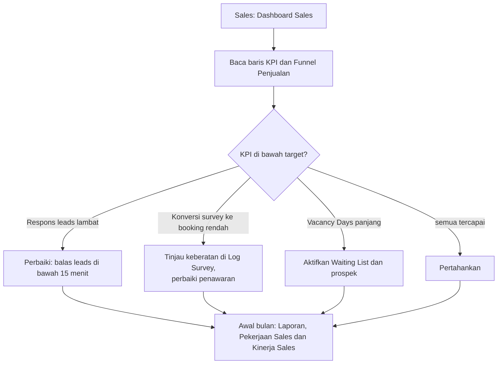

# Diagram Alir Kasus Operasional: Sales

Peran: memegang semua urusan setelah leads diserahkan Marketing. Survey, booking, waiting list, dan menjaga penghuni supaya memperpanjang.

Aplikasi yang dipakai: **Mini App** (Log Survey, Tambah Waiting List, Tugas Harian, Riwayat Pembayaran hanya melihat, Laporan), **Dashboard** (Overview, Daftar Prospek, Daftar Penghuni tanpa data pribadi, Data Kamar, Waiting List, Dokumen, Target KPI). **Teman Rara** dan **Inventory** tidak punya menu untuk Sales; hal-hal dari Teman Rara yang memengaruhi Sales dijelaskan di K4 dan K6.

Sales tidak punya form booking. Booking dicatat Admin and Finance.

Cara membaca diagram: kotak = langkah, belah ketupat = keputusan. Nama di awal kotak menunjukkan siapa yang mengerjakan.

| No | Kasus | Aplikasi |
|---|---|---|
| K1 | Leads baru sampai booking | Mini App, Dashboard |
| K2 | Tidak ada kamar kosong: Waiting List | Mini App, Dashboard |
| K3 | Prospek yang belum survey atau belum booking | Dashboard |
| K4 | Calon penghuni mendaftar sendiri lewat Teman Rara | Teman Rara (lewat Admin) |
| K5 | Booking batal | Dashboard |
| K6 | Penghuni bertanya soal pengaduan, bukti bayar, atau akun Teman Rara | Teman Rara (lewat Admin) |
| K7 | Perpanjangan sewa dan Renewal Rate | Dashboard, Mini App |
| K8 | Kamar baru kosong dan antrean Waiting List | Dashboard, Mini App |
| K9 | Evaluasi mingguan dan laporan Kinerja Sales | Dashboard, Mini App |

---

## K1. Leads baru sampai booking

**Kapan terjadi:** Marketing mencatat leads baru. Target respons pertama paling lama 15 menit.

**Checklist**
- [ ] Survey dicatat di hari yang sama, lengkap dengan hasil dan tanggal follow-up.
- [ ] Nomor HP calon penghuni benar (satu orang satu baris dicocokkan lewat nomor HP).
- [ ] Booking dari survey cepat dikabarkan ke Admin and Finance, karena angka Booking bergantung padanya.

---

## K2. Tidak ada kamar kosong: Waiting List

**Kapan terjadi:** calon penghuni ingin masuk tapi semua kamar Terisi, Booking, atau Maintenance.

**Perhatikan:** status Waiting List: Menunggu, Dihubungi, Closed. Ubah lewat Edit di panel daftar.

---

## K3. Prospek yang belum survey atau belum booking

**Kapan terjadi:** follow-up mingguan.

---

## K4. Calon penghuni mendaftar sendiri lewat Teman Rara

**Kapan terjadi:** calon yang sudah kamu survey (atau belum) mengisi form di aplikasi Teman Rara.

**Perhatikan:** Sales tidak bisa membuka panel pendaftaran mandiri. Semua review dilakukan Admin and Finance.

---

## K5. Booking batal

**Kapan terjadi:** calon penghuni membatalkan, atau pendaftaran ditolak.

---

## K6. Penghuni bertanya soal pengaduan, bukti bayar, atau akun Teman Rara

**Kapan terjadi:** penghuni menghubungi Sales untuk hal yang bukan wewenang Sales.

---

## K7. Perpanjangan sewa dan Renewal Rate

**Kapan terjadi:** bulanan, untuk penghuni yang sewanya akan jatuh tempo.

**Perhatikan:** invoice yang di-void tidak dihitung sebagai tagihan atau pengingat. Rata-rata lama sewa ditargetkan minimal 3 bulan.

---

## K8. Kamar baru kosong dan antrean Waiting List

**Kapan terjadi:** penghuni checkout atau booking batal membuat kamar tersedia.

**Perhatikan:** kamar Maintenance atau Booking tidak muncul sebagai kamar tersedia. Waiting List tidak otomatis memberi tahu Sales, jadi pemeriksaannya manual.

---

## K9. Evaluasi mingguan dan laporan Kinerja Sales

**Kapan terjadi:** tiap minggu dan awal bulan.

---

## Ringkasan: kasus, KPI, dan target

| Kasus | KPI | Target |
|---|---|---|
| K1 | Respons leads pertama | Paling lama 15 menit |
| K1 | Konversi Leads ke Survey | 90% |
| K1 | Konversi Survey ke Booking | 90% |
| K1, K4 | Booking baru | Minimal 1 per bulan |
| K2, K8 | Waiting List | Antrean sekitar 5 orang |
| K5 | Cancellation rate | Paling tinggi 20% |
| K7 | Renewal rate | 100% |
| K7 | Rata-rata lama sewa | Minimal 3 bulan |
| K7, K8 | Vacancy days | Paling lama 30 hari |
| K1, K7 | Okupansi | 100% |
